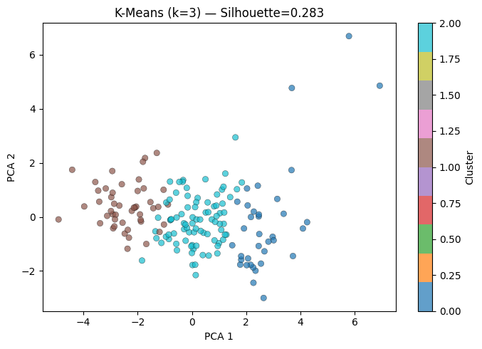
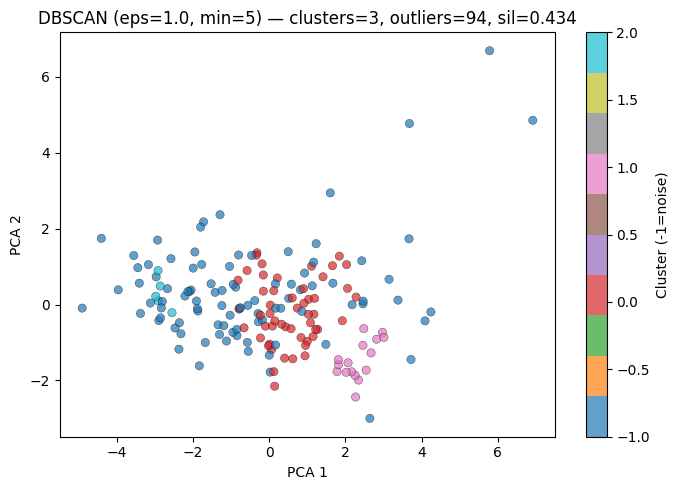

# Country Clustering — Unsupervised Segmentation of 167 Countries

Unsupervised segmentation of 167 countries by socio-economic and health indicators. K-Means, Agglomerative, DBSCAN and Gaussian Mixture clustering are compared with the silhouette score, and the clusters are interpreted as developed, developing and least developed country groups.

## Problem
Group countries with similar development profiles **without labels**, and check whether the data supports the intuitive split into **developed / developing / least developed** countries. The second goal is to compare one algorithm from each family of clustering methods (partitional, hierarchical, density-based, probabilistic) and pick a segmentation that is both statistically sound and interpretable.

## Data
- **Source:** [Unsupervised Learning on Country Data — Kaggle](https://www.kaggle.com/datasets/rohan0301/unsupervised-learning-on-country-data/data)
- **Size:** 167 countries × 9 numeric indicators, with no missing values. The indicators are `child_mort`, `exports`, `health`, `imports`, `income`, `inflation`, `life_expec`, `total_fer` and `gdpp`.
- The data is small, so it is included in [`data/`](data/): `Country-data.csv` and `data-dictionary.csv` (column definitions).

## Approach
- EDA: pairplot, distributions, boxplots and a correlation heatmap
- `StandardScaler` on all 9 features, since `gdpp` goes up to 105,000 while `health` stays at most 17.9
- PCA with 2 components **for visualization only** (46.0% + 17.2% = 63.1% of variance); clustering runs on all 9 scaled features
- Choosing K: Elbow method (K-Means inertia, K = 2…9) and a Ward dendrogram
- 16 configurations compared with the **silhouette score**:
  - K-Means, k = 2…5
  - Agglomerative clustering with Ward linkage, k = 2…5
  - GMM, k = 2…5
  - DBSCAN on an `eps` × `min_samples` grid
- Final model: K-Means with k = 3, then the average indicators per cluster are used to interpret it

## Results

| # | Model | Clusters | Silhouette | Outliers (noise) |
|---|---|---|---|---|
| 1 | DBSCAN | 3 | 0.434 | **94** |
| 2 | DBSCAN | 8 | 0.412 | 137 |
| 3 | Agglomerative | 2 | 0.315 | 0 |
| 4 | DBSCAN | 6 | 0.309 | 72 |
| 5 | K-Means | 5 | 0.299 | 0 |
| 6 | K-Means | 4 | 0.296 | 0 |
| 7 | K-Means | 2 | 0.287 | 0 |
| 8 | **K-Means (chosen)** | **3** | **0.283** | **0** |
| 9 | GMM | 2 | 0.258 | 0 |
| 10 | Agglomerative | 4 | 0.248 | 0 |
| 11 | Agglomerative | 3 | 0.246 | 0 |
| 12 | GMM | 5 | 0.226 | 0 |
| 13 | DBSCAN | 2 | 0.226 | 25 |
| 14 | Agglomerative | 5 | 0.219 | 0 |
| 15 | GMM | 4 | 0.200 | 0 |
| 16 | GMM | 3 | 0.192 | 0 |

> **Why not DBSCAN?** It has the highest silhouette (~0.43, eps = 1.0, min_samples = 5), but it labels **94 of the 167 countries as noise**. Its silhouette is computed only on the 73 remaining countries, so the high score describes a small, dense subset rather than a segmentation of the dataset. It is not a useful result here, but it does show that the data has no uniform density.

**Chosen model: K-Means, k = 3.**
- The Elbow curve and the dendrogram both point to 3 groups.
- Every country gets a cluster.
- The three clusters map cleanly onto development levels.

Among the methods that assign every country, silhouette scores are close (0.19–0.32), so interpretability decided the choice. Agglomerative with k = 2 scores slightly higher (0.315) but only separates two groups.

**Cluster profiles** (mean values, K-Means k = 3):

| Cluster | Countries | Child mortality (per 1,000) | Income per person | GDP per capita | Life expectancy | Health spending (% GDP) | Profile |
|---|---|---|---|---|---|---|---|
| 0 | 36 | 5.0 | 45,672 | 42,494 | 80.1 | 8.81 | **Developed** (e.g. Australia, Austria, Canada, Germany) |
| 2 | 84 | 21.9 | 12,306 | 6,486 | 72.8 | 6.20 | **Developing** (e.g. Albania, Algeria, Argentina, Brazil) |
| 1 | 47 | 93.0 | 3,942 | 1,922 | 59.2 | 6.39 | **Least developed** (e.g. Afghanistan, Angola, Burkina Faso, Chad) |

| K-Means k = 3 (PCA projection) | DBSCAN with the best silhouette: 94 outliers |
|---|---|
|  |  |

Cluster colors in the left plot: 0 = blue (developed), 1 = brown (least developed), 2 = cyan (developing). DBSCAN noise points are shown in blue (`-1`). Other charts are in [`images/`](images/): silhouette comparison, elbow curve, dendrogram and correlation heatmap. They were redrawn in English. The silhouette chart uses the notebook's results table. The other three were recomputed from `data/Country-data.csv` with the notebook's code, which was first checked to reproduce all 16 silhouette scores exactly.

## Key takeaway
**The best metric score does not mean the best segmentation.** DBSCAN wins on silhouette only by discarding 56% of the countries as noise. K-Means with k = 3 scores lower but gives a complete and stable segmentation with a clear meaning. Child mortality ranges from 5 to 93 per 1,000 across the three groups, and income per person from about 45.7k down to 3.9k. Standardizing the features first was essential, because without it `gdpp` and `income` would dominate every distance.

## How to run
```bash
git clone https://github.com/mihaimiron1/country-clustering-unsupervised.git
cd country-clustering-unsupervised
pip install -r requirements.txt jupyter
jupyter notebook notebooks/country_clustering.ipynb
```

## Project structure
```
├── data/                         # Country-data.csv, data-dictionary.csv
├── images/                       # PCA scatter plots from the notebook + charts redrawn in English
├── notebooks/country_clustering.ipynb
└── requirements.txt
```

## Next steps
- Interactive world choropleth map of the clusters with Plotly (`px.choropleth`)
- Cluster stability: repeat K-Means with different seeds or bootstrap samples, and add the Davies–Bouldin and Calinski–Harabasz indices
- Robust scaling or a log transform for the skewed features (`income`, `gdpp`, `inflation`)
- Use the segmentation as a ranked shortlist, for example to prioritize countries for development aid

---
Developed as part of the Artificial Intelligence course at the Technical University of Moldova.

**Author:** Mihai Miron
